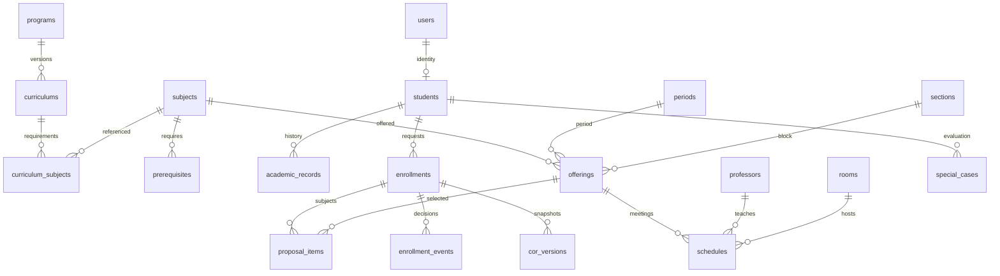

# Academic database design

The design separates master subjects, versioned curriculum requirements, semester offerings, scheduled classes and enrollment snapshots. Students belong to one curriculum version. Each offering is a capacity-controlled subject section; a student can take offerings across blocks. Pending proposals do not reserve seats. Capacity is rechecked under locks at finalization. If a class fills first, the Registrar must revise the proposal. Section capacity counts distinct finalized students across all offerings in the section. Each offering separately enforces its own capacity. Both checks run under the period locks at proposal/finalization; reopening an enrollment removes that student from finalized section counts.

Unique constraints: external admission and employee identifiers, student email via users, subject/program/room codes, period label, student plus period enrollment, proposal version plus offering, and schedule assignment uniqueness. Foreign keys preserve referenced records. Administrative removal is replaced by deactivation. Registrar-owned data entry uses validation and audit logs. Academic evaluations and proposal decisions are recorded independently.

Before production: validate this schema and per-offering capacity policy with PLP, test locking behavior on MariaDB, and confirm source contracts and grading policy. Development policy requires PASSED or CREDITED for prerequisites, with alternative prerequisite groups supported. No numeric passing-grade rule is assumed.
Additional normalized tables: buildings and floors; room_closures for period-specific recurring restrictions; academic_overrides for student/subject/period exceptions with the approving user; portal_notifications with per-user read status; personal_access_tokens with hashed tokens, abilities and expiration. Subjects include department and description; rooms support equipment and a dedicated subject; prerequisites support optional minimum grades. Periods explicitly record the academic year and semester.
